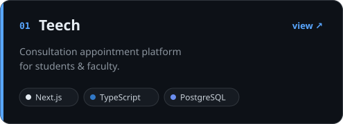
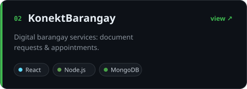
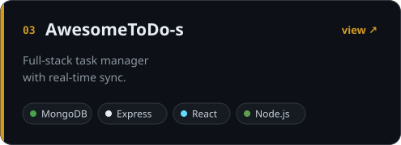
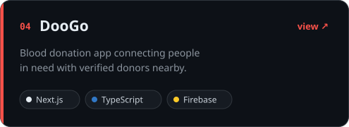

<!-- ░░ HEADER ░░ -->

<!-- ░░ ABOUT ░░ -->

<!-- ░░ PROJECTS (2x2 grid) ░░ -->
<h3 align="center">🚀 Featured projects</h3>

<!-- ░░ TECH STACK (animated) ░░ -->
<h3 align="center">🛠 Tech I work with</h3>

<!-- ░░ STATS ░░ -->
<h3 align="center">📊 GitHub at a glance</h3>

<!-- ░░ SNAKE ░░ -->

<picture>
<source media="(prefers-color-scheme: dark)" srcset="./assets/snake-dark.svg" />
<source media="(prefers-color-scheme: light)" srcset="./assets/snake-light.svg" />

</picture>

<!-- ░░ FOOTER ░░ -->

<i>"final fix" → "final fix for real" → "ok THIS is the final fix"</i>

 ⭐ <b>Like something here? Drop a star now!</b> ⭐

